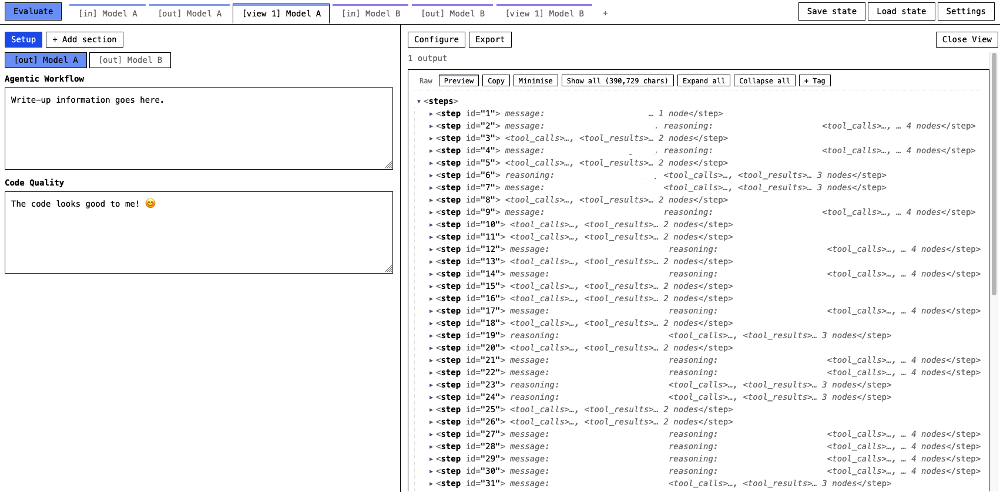
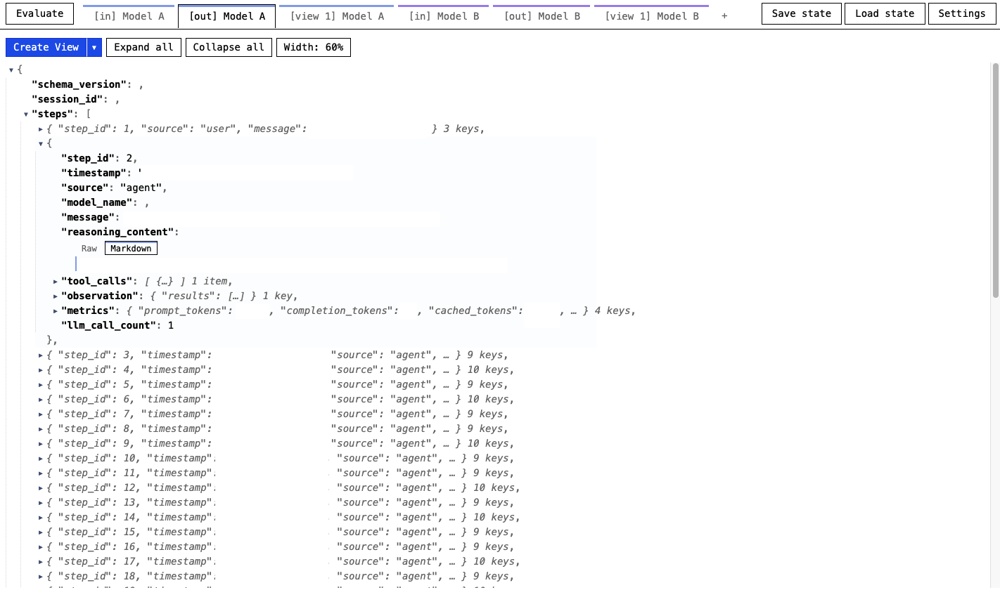
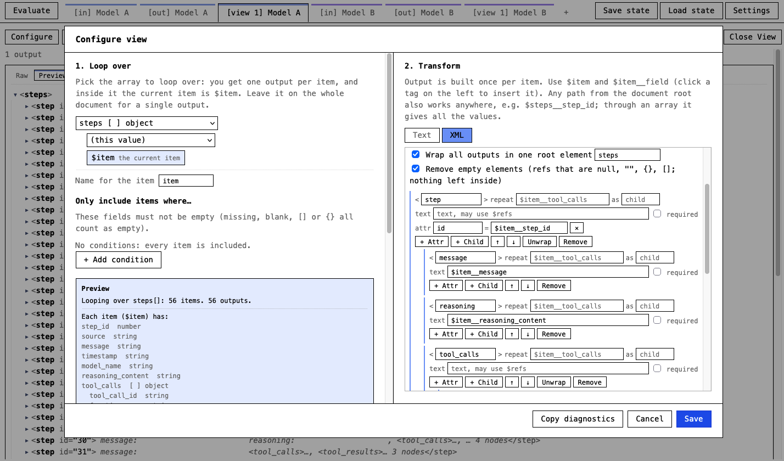
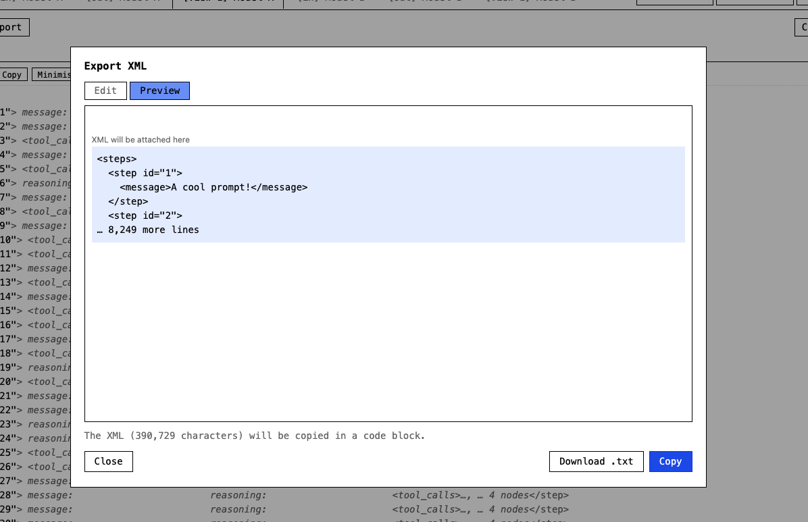

# JSON Trajectory Viewer

An app for viewing, comparing and evaluating JSON LLM trajectories.

## Running

Serve the directory with Python's built-in web server, then open <http://localhost:8000>:

```sh
python3 -m http.server
```

## Screenshots



*Evaluating: the Evaluate sidebar holds a write-up alongside the data being reviewed.*



*Viewing JSON: rendered as browsable trees.*



*XML view config: configure how JSON is converted to XML (select -> transform). XML because I think it is more human readable than JSON for this work.*



*XML export: the generated XML, for usage in external tooling, if necessary.*
